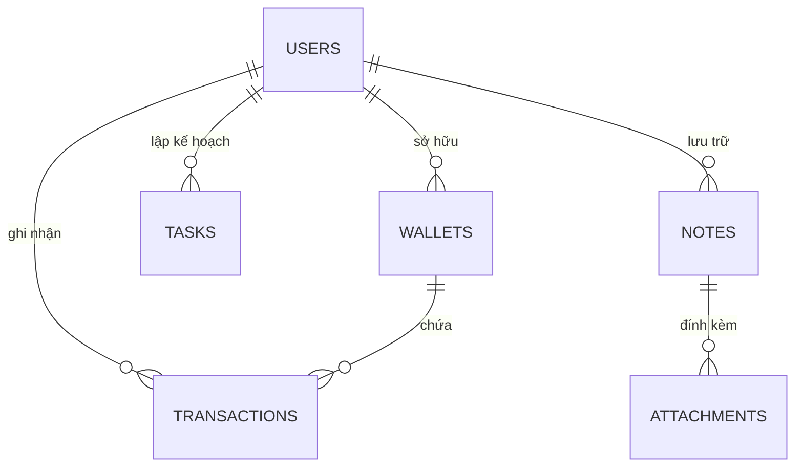

# Tài liệu Đặc tả Yêu cầu Sản phẩm (PRD) — Dự án FLUX
**Tên sản phẩm:** Flux — Personal Productivity & Financial Workspace  
**Phiên bản:** 1.0 (Bản đặc tả chính thức)  
**Mục tiêu:** Ứng dụng cá nhân All-in-one tinh gọn, hiệu năng cao và bảo mật nghiêm ngặt.  
**Tech Stack:** Node.js (TypeScript) | React (TypeScript) + TailwindCSS + shadcn/ui | PostgreSQL + Redis | S3 / Cloudflare R2  

---

## 1. Tổng quan Dự án (Project Overview)

### 1.1. Tầm nhìn & Mục tiêu Sản phẩm
**Flux** là một **Không gian làm việc cá nhân toàn diện (Personal All-in-one Workspace)**, hợp nhất ba nhu cầu cốt lõi hàng ngày của một cá nhân vào một nền tảng duy nhất:
1. **Quản lý Tài chính Cá nhân (Finance):** Theo dõi số dư các ví, kiểm soát thu chi, chuyển khoản và trực quan hóa dòng tiền.
2. **Quản lý Công việc & Năng suất (Tasks):** Lập kế hoạch to-do list, theo dõi tiến độ công việc theo mức độ ưu tiên và chu kỳ lặp lại.
3. **Kho Tri thức & Ghi chú (Notes):** Lưu trữ ý tưởng, tài liệu, danh sách và hình ảnh dưới định dạng Markdown với khả năng tìm kiếm tức thì.

Ứng dụng hướng tới sự **tinh gọn, trực quan, không rườm rà**, phục vụ tối đa trải nghiệm cá nhân hóa nhưng được xây dựng trên nền tảng **bảo mật web chuẩn mực** nhằm bảo vệ an toàn tuyệt đối dữ liệu tài sản và thông tin cá nhân.

### 1.2. Đối tượng Người dùng
* Học sinh, sinh viên, người đi làm, người làm nghề tự do (Freelancers) cần một giải pháp quản lý cuộc sống cá nhân độc lập, riêng tư, an toàn và dễ sử dụng trên cả máy tính lẫn điện thoại di động.

---

## 2. Kiến trúc Hệ thống & Công nghệ (Architecture & Tech Stack)

```
       +-------------------------------------------------------------+
       |                        CLIENT TIER                          |
       |  React 18+ (TypeScript) + Vite + TailwindCSS + shadcn/ui   |
       |  Zustand / TanStack Query + Lucide Icons + Recharts         |
       +------------------------------+------------------------------+
                                      | HTTPS (TLS 1.3)
                                      v
       +-------------------------------------------------------------+
       |                  SECURITY & GATEWAY LAYER                   |
       |  Helmet Security Headers + Strict CORS                      |
       |  Redis Token Bucket Rate Limiter + IP Brute-Force Shield    |
       +------------------------------+------------------------------+
                                      |
                                      v
       +-------------------------------------------------------------+
       |                    BACKEND APPLICATION                      |
       |  Node.js (TypeScript) - Modular Layered Architecture         |
       |  Auth: Dual JWT (Access In-Memory + Rotated Refresh Cookie) |
       |  Validation: Zod Strict Schemas (Zero-Trust Input)          |
       |  Sanitization: DOMPurify (Markdown) + Parameterized SQL     |
       +--------------+---------------+--------------+---------------+
                      |               |              |
                      v               v              v
        +-------------------+  +-------------+  +-------------------+
        |   PostgreSQL 16   |  | Redis Cache |  | Object Storage    |
        | - Users, Wallets  |  | - Token     |  | - S3 / R2 / MinIO |
        | - Transactions    |  |   Blacklist |  | - Pre-signed URLs |
        | - Tasks, Notes    |  | - Rate Limit|  | - Secure Files    |
        | - Row-Level Lock  |  | - Sessions  |  |                   |
        +-------------------+  +-------------+  +-------------------+
```

### Thành phần Kỹ thuật:
* **Frontend:** React 18+ với TypeScript, Vite, TailwindCSS, shadcn/ui (Radix UI primitives), Recharts/Chart.js cho biểu đồ tài chính, Lucide React cho bộ icon nhất quán.
* **Backend:** Node.js (v20+ LTS) với TypeScript, áp dụng mô hình Modular Layered Architecture (Controller -> Service -> Repository).
* **Cơ sở dữ liệu:** PostgreSQL 16+ kết hợp Prisma / Drizzle ORM. Lưu trữ kiểu số học `NUMERIC(15, 2)` cho tiền tệ và `JSONB` cho Tags/metadata của ghi chú. Sử dụng Database ACID Transaction kết hợp khóa dòng `SELECT FOR UPDATE` khi giao dịch chuyển tiền giữa các ví.
* **Bộ nhớ đệm & Phiên (Cache & Session):** Redis 7+ phục vụ Token Blacklist, kiểm soát tần suất truy cập (Rate Limiting) và Session Cache.
* **Lưu trữ Tệp tin (Object Storage):** AWS S3 / Cloudflare R2 / MinIO. Tải file an toàn qua cơ chế Pre-signed URLs.

---

## 3. Hệ thống An ninh & Bảo mật Web Toàn diện (Web Security Architecture)

Hệ thống được thiết kế theo nguyên lý phòng thủ theo chiều sâu (Defense-in-Depth) nhằm đảm bảo dữ liệu cá nhân của người dùng luôn được bảo vệ nghiêm ngặt:

### 3.1. Xác thực & Quản lý Phiên (Authentication & Session)
* **Kiến trúc Dual JWT Token:**
  * **Access Token:** Tuổi thọ ngắn (**15 phút**), ký bằng secret key mạnh (256-bit+), lưu trữ trực tiếp trong **Memory** của Frontend (không lưu vào localStorage để loại trừ nguy cơ bị mã độc XSS đánh cắp).
  * **Refresh Token:** Tuổi thọ **7 ngày** (hoặc 30 ngày nếu chọn ghi nhớ), chuỗi ngẫu nhiên mật mã (64 bytes cryptographic string). Lưu trữ trong Cookie với đầy đủ các thuộc tính bảo vệ nghiêm ngặt:  
    `HttpOnly; Secure; SameSite=Strict; Path=/api/v1/auth/refresh`.
  * **Xoay vòng Token (Refresh Token Rotation - RTR):** Mỗi khi cấp lại Access Token mới, hệ thống tự động hủy Refresh Token cũ và cấp một Refresh Token mới. Nếu phát hiện Refresh Token cũ bị gửi lại (dấu hiệu lộ token), hệ thống lập tức thu hồi toàn bộ session của tài khoản đó.
* **Thu hồi Token khi Đăng xuất (Redis Blacklist):**
  * Khi người dùng Đăng xuất hoặc Đổi mật khẩu, Refresh Token trong DB bị đánh dấu hủy (`revoked = true`).
  * Access Token hiện tại được đẩy vào Redis Blacklist với TTL bằng thời gian sống còn lại của token.
* **Chính sách Mật khẩu & Chống Tấn công Dò quét (Brute-Force Shield):**
  * Mật khẩu được băm bằng thuật toán **Argon2id** (hoặc **BCrypt** với Work Factor = 12).
  * Quy tắc mật khẩu: Tối thiểu 8 ký tự, gồm ít nhất 1 chữ hoa, 1 chữ thường, 1 số và 1 ký tự đặc biệt. Từ chối mật khẩu nằm trong danh sách rò rỉ phổ biến.
  * **Khóa tài khoản tạm thời:** Khóa đăng nhập tài khoản 15 phút nếu nhập sai mật khẩu 5 lần liên tiếp.
* **Xác thực Đa yếu tố Tùy chọn (2FA / TOTP):**
  * Hỗ trợ chuẩn RFC 6238 (tương thích Google Authenticator, Microsoft Authenticator, 1Password) để tăng cường bảo vệ tài khoản tài chính cá nhân.
  * Cấp 8 mã dự phòng (One-time backup codes) được băm một chiều khi kích hoạt.

### 3.2. Bảo vệ Tầng Mạng, API & Security Headers
* **HTTP Security Headers (Cấu hình qua Helmet middleware):**
  * `Strict-Transport-Security (HSTS)`: `max-age=63072000; includeSubDomains; preload` (Bắt buộc HTTPS).
  * `X-Frame-Options`: `DENY` (Chống Clickjacking).
  * `X-Content-Type-Options`: `nosniff` (Chống MIME Sniffing).
  * `Referrer-Policy`: `strict-origin-when-cross-origin`.
  * `Content-Security-Policy (CSP)`: Ràng buộc chặt chẽ nguồn nạp tài nguyên, cấm inline script nguy hiểm.
* **CORS Nghiêm ngặt:** Chỉ cho phép domain Frontend chính thức được cấu hình trong Environment Variables gọi API.
* **Kiểm soát Tần suất Truy cập (API Rate Limiting qua Redis):**
  * Nhóm Xác thực (`/api/v1/auth/*`): Tối đa 5 requests / phút / IP.
  * Nhóm Tải tệp (`/api/v1/upload/*`): Tối đa 10 requests / phút / User.
  * Nhóm Nghiệp vụ thông thường: Tối đa 120 requests / phút / User.

### 3.3. Xử lý Dữ liệu Đầu vào & Chống Lỗ hổng Phổ biến (OWASP Top 10)
* **Zero-Trust Input Validation:** Mọi Request Body, Query, Params đều phải vượt qua bộ lọc Schema chặt chẽ bằng **Zod**. Loại bỏ hoàn toàn các trường dữ liệu thừa (Strip unknown keys) để chống Mass Assignment và Prototype Pollution.
* **Chống SQL Injection:** 100% truy vấn cơ sở dữ liệu được tham số hóa (Parameterized Queries) thông qua ORM. Tuyệt đối không nối chuỗi raw SQL.
* **Chống Stored XSS trong Ghi chú:** Toàn bộ nội dung Markdown của người dùng được làm sạch bằng **DOMPurify** ở cả Client và Server trước khi lưu và hiển thị.
* **Chống IDOR (Insecure Direct Object Reference):** Tất cả khóa chính sử dụng định dạng **UUIDv4**. Mọi truy vấn đọc/ghi tài nguyên đều gắn kèm điều kiện quyền sở hữu cá nhân: `WHERE id = :id AND user_id = :authenticated_user_id`.
* **Độ chính xác Tài chính & Chống Race Condition:**
  * Toàn bộ số tiền lưu trữ dạng `NUMERIC(15, 2)`. Tính toán số dư bằng thư viện `decimal.js` (không dùng số thực float mặc định của JS để tránh lỗi làm tròn).
  * Chuyển tiền giữa các ví cá nhân được bọc trong một Database ACID Transaction duy nhất có khóa dòng `SELECT ... FOR UPDATE` để chống xung đột dữ liệu.

### 3.4. Bảo mật Tải lên Tệp tin (Secure File Uploads)
* **Xác thực Magic Bytes nhị phân:** Kiểm tra Header nhị phân thực tế của tệp tin (thư viện `file-type`), không tin tưởng đuôi mở rộng file hoặc header HTTP Content-Type do trình duyệt gửi.
* **Whitelist Định dạng an toàn:**
  * Hình ảnh: `image/jpeg`, `image/png`, `image/webp`.
  * Tài liệu: `application/pdf`, `text/plain`.
  * Tuyệt đối cấm các file thực thi và file có nguy cơ chứa mã độc: `.exe, .sh, .bat, .php, .js, .html, .svg`.
* **Lưu trữ Cô lập:** Đổi tên tệp ngẫu nhiên bằng `UUIDv4`, tải trực tiếp lên Object Storage qua **Pre-signed URLs** có hạn dùng ngắn (15 phút), không lưu file trên ổ đĩa server backend.
* **Giới hạn dung lượng:** Tối đa 5MB/tệp, tổng dung lượng đính kèm không vượt quá 20MB/ghi chú.

---

## 4. Yêu cầu Chức năng Chi tiết (Functional Requirements)

### 4.1. Phân hệ Xác thực & Tài khoản Cá nhân (Auth & Profile)
* **F-AUTH-01: Đăng ký & Kích hoạt Email:**
  * Đăng ký bằng Email và Mật khẩu. Gửi email xác thực tài khoản kèm token có chữ ký số HMAC thời hạn 15 phút.
* **F-AUTH-02: Đăng nhập & Xác thực 2FA:**
  * Đăng nhập an toàn, cấp cặp Dual JWT Token. Nếu tài khoản đã kích hoạt 2FA, yêu cầu nhập mã TOTP 6 chữ số.
* **F-AUTH-03: Quản lý Bảo mật Cá nhân:**
  * Đổi mật khẩu (yêu cầu mật khẩu hiện tại), Quên mật khẩu qua email, Bật/Tắt 2FA, Xem danh sách phiên đăng nhập và Đăng xuất khỏi tất cả các thiết bị.

### 4.2. Bảng điều khiển Tổng hợp (Personal Unified Dashboard)
* **F-DASH-01: Widget Tổng quan Tài chính:**
  * Hiển thị Tổng số dư hiện tại của tất cả các ví cá nhân.
  * Thống kê dòng tiền Thu - Chi trong tháng hiện tại và tỷ lệ biến động so với tháng trước.
* **F-DASH-02: Widget Việc cần làm Gấp (Smart Priority To-Do):**
  * Tự động lọc ra 5 công việc khẩn cấp nhất: Ưu tiên công việc Quá hạn (Overdue) -> Đến hạn hôm nay (Due Today) -> Mức độ High Priority.
  * Cho phép bấm checkbox hoàn thành công việc trực tiếp trên widget với hiệu ứng gạch ngang tức thì.
* **F-DASH-03: Widget Ghi chú Ghim (Pinned Notes):**
  * Hiển thị 3 ghi chú được ghim (pinned) mới nhất, click mở nhanh modal xem hoặc chỉnh sửa.
* **F-DASH-04: Thanh Thao tác Nhanh (Quick Action Floating Bar):**
  * Nút bấm nhanh (+) để mở Modal thêm mới: Giao dịch tài chính, Công việc mới, hoặc Ghi chú nhanh mà không cần chuyển trang.

### 4.3. Phân hệ Quản lý Tài chính Cá nhân (Finance Management)
* **F-FIN-01: Quản lý Ví tiền (Wallets):**
  * Người dùng có thể tạo nhiều ví cá nhân (Ví tiền mặt, Tài khoản ngân hàng, Ví tiết kiệm, Thẻ tín dụng,...).
  * Thuộc tính ví: Tên ví, Loại tiền tệ (VND, USD,...), Số dư ban đầu, Biểu tượng (Icon), Màu sắc nhận diện.
* **F-FIN-02: Quản lý Giao dịch (Transactions):**
  * Phân loại: **Thu (Income)**, **Chi (Expense)**, **Chuyển khoản (Transfer)**.
  * Thuộc tính: Số tiền, Ví áp dụng, Danh mục (Ăn uống, Mua sắm, Lương, Hóa đơn,...), Ngày giờ phát sinh, Ghi chú, Ảnh hóa đơn đính kèm.
* **F-FIN-03: Logic Chuyển khoản Giữa các Ví:**
  * Khi chọn loại "Chuyển khoản", người dùng chọn Ví nguồn và Ví đích.
  * Hệ thống tự động trừ tiền ở Ví nguồn và cộng tiền ở Ví đích trong một Database Transaction duy nhất, đảm bảo tính toàn vẹn số dư.
* **F-FIN-04: Báo cáo & Phân tích Trực quan:**
  * Biểu đồ tròn (Donut/Pie Chart): Cơ cấu chi tiêu theo từng danh mục trong tháng hoặc theo khoảng thời gian tùy chọn.
  * Biểu đồ cột đôi (Bar Chart): So sánh dòng tiền Thu nhập đối chiếu Chi tiêu theo từng tháng trong năm.
  * Xuất dữ liệu: Hỗ trợ xuất danh sách giao dịch ra file CSV / Excel để lưu trữ hoặc đối soát cá nhân.

### 4.4. Phân hệ Quản lý Công việc & Năng suất (Personal To-Do)
* **F-TASK-01: Quản lý Công việc (Tasks):**
  * Thuộc tính: Tiêu đề công việc, Mô tả chi tiết (hỗ trợ checklist con / sub-items), Hạn chót (Deadline có ngày và giờ), Mức độ ưu tiên (Low, Medium, High, Urgent).
* **F-TASK-02: Trạng thái & Tương tác:**
  * Trạng thái: To-Do (Cần làm), In Progress (Đang làm), Done (Đã hoàn thành).
  * Thao tác: Bấm checkbox hoàn thành kèm hiệu ứng âm thanh/chuyển động nhẹ và gạch ngang chữ.
* **F-TASK-03: Công việc Lặp lại Định kỳ (Recurring Tasks):**
  * Thiết lập công việc tự động lặp lại theo chu kỳ: Hàng ngày, Hàng tuần (chọn các ngày trong tuần), Hàng tháng.
* **F-TASK-04: Chế độ Xem & Bộ lọc Thông minh:**
  * **List View:** Danh sách tinh gọn cho phép sắp xếp theo Deadline hoặc Priority.
  * **Kanban Board:** Kéo thả (Drag & Drop) mượt mà giữa các cột trạng thái.
  * Bộ lọc nhanh: Hôm nay (Today), 7 ngày tới (Next 7 days), Quá hạn (Overdue), và Đã hoàn thành (Completed).

### 4.5. Phân hệ Ghi chú & Kho Tri thức (Personal Notes)
* **F-NOTE-01: Soạn thảo Ghi chú Đa năng (Rich Markdown Editor):**
  * Trình soạn thảo hỗ trợ Markdown đầy đủ: Tiêu đề (H1-H3), In đậm, In nghiêng, Danh sách gạch đầu dòng, Task list (checkbox), Trích dẫn, Khối mã nguồn (Code block), Bảng (Table).
  * Tùy biến: Chọn màu nền thẻ ghi chú (Color Coding), Gắn danh sách nhãn (Tags linh hoạt), Đánh dấu Ghim lên đầu danh sách (Pin).
* **F-NOTE-02: Tệp đính kèm Đa phương tiện An toàn:**
  * Cho phép kéo thả hình ảnh và tệp tài liệu PDF đính kèm vào ghi chú. Tối ưu preview ảnh và mở tệp an toàn qua pre-signed URL.
* **F-NOTE-03: Tìm kiếm Toàn văn Tức thì (Full-Text Search):**
  * Sử dụng PostgreSQL Full-Text Search (`tsvector` & `tsquery` tiếng Việt / tiếng Anh không dấu) để tìm kiếm tức thì theo từ khóa xuất hiện trong tiêu đề, nội dung ghi chú và nhãn tag.
* **F-NOTE-04: Chế độ hiển thị:**
  * Chuyển đổi linh hoạt giữa Dạng lưới (Grid Cards — phong cách Google Keep) và Dạng danh sách tinh gọn (List View).

---

## 5. Thiết kế Cơ sở Dữ liệu Chi tiết (Database Schema)



### 5.1. Bảng `users`
* `id` (UUID, PK, default `gen_random_uuid()`)
* `email` (VARCHAR(255), UNIQUE, NOT NULL, INDEX)
* `password_hash` (VARCHAR(255), NOT NULL)
* `full_name` (VARCHAR(100), NOT NULL)
* `avatar_url` (VARCHAR(500), NULL)
* `is_email_verified` (BOOLEAN, default FALSE)
* `two_factor_enabled` (BOOLEAN, default FALSE)
* `two_factor_secret` (VARCHAR(255), NULL)
* `backup_codes` (JSONB, default '[]')
* `failed_login_attempts` (INTEGER, default 0)
* `locked_until` (TIMESTAMPTZ, NULL)
* `created_at` (TIMESTAMPTZ, default NOW())
* `updated_at` (TIMESTAMPTZ, default NOW())

### 5.2. Bảng `wallets`
* `id` (UUID, PK, default `gen_random_uuid()`)
* `user_id` (UUID, FK -> users.id ON DELETE CASCADE, NOT NULL, INDEX)
* `name` (VARCHAR(100), NOT NULL)
* `currency` (VARCHAR(10), default 'VND')
* `initial_balance` (NUMERIC(15, 2), default 0.00)
* `current_balance` (NUMERIC(15, 2), default 0.00)
* `icon` (VARCHAR(50), default 'wallet')
* `color` (VARCHAR(20), default '#6366F1')
* `created_at` (TIMESTAMPTZ, default NOW())
* `updated_at` (TIMESTAMPTZ, default NOW())

### 5.3. Bảng `transactions`
* `id` (UUID, PK, default `gen_random_uuid()`)
* `user_id` (UUID, FK -> users.id ON DELETE CASCADE, NOT NULL, INDEX)
* `wallet_id` (UUID, FK -> wallets.id ON DELETE RESTRICT, NOT NULL, INDEX)
* `destination_wallet_id` (UUID, FK -> wallets.id ON DELETE RESTRICT, NULL) -- Dùng khi type = 'TRANSFER'
* `type` (VARCHAR(20), NOT NULL) -- 'INCOME', 'EXPENSE', 'TRANSFER'
* `amount` (NUMERIC(15, 2), NOT NULL)
* `category` (VARCHAR(100), NOT NULL, INDEX)
* `transaction_date` (TIMESTAMPTZ, NOT NULL, INDEX)
* `note` (TEXT, NULL)
* `receipt_url` (VARCHAR(500), NULL)
* `created_at` (TIMESTAMPTZ, default NOW())

### 5.4. Bảng `tasks`
* `id` (UUID, PK, default `gen_random_uuid()`)
* `user_id` (UUID, FK -> users.id ON DELETE CASCADE, NOT NULL, INDEX)
* `title` (VARCHAR(255), NOT NULL)
* `description` (TEXT, NULL)
* `status` (VARCHAR(20), default 'TODO') -- 'TODO', 'IN_PROGRESS', 'DONE'
* `priority` (VARCHAR(10), default 'MEDIUM') -- 'LOW', 'MEDIUM', 'HIGH', 'URGENT'
* `due_date` (TIMESTAMPTZ, NULL, INDEX)
* `is_recurring` (BOOLEAN, default FALSE)
* `recurrence_rule` (VARCHAR(50), NULL) -- 'DAILY', 'WEEKLY', 'MONTHLY'
* `completed_at` (TIMESTAMPTZ, NULL)
* `created_at` (TIMESTAMPTZ, default NOW())
* `updated_at` (TIMESTAMPTZ, default NOW())

### 5.5. Bảng `notes`
* `id` (UUID, PK, default `gen_random_uuid()`)
* `user_id` (UUID, FK -> users.id ON DELETE CASCADE, NOT NULL, INDEX)
* `title` (VARCHAR(255), NOT NULL)
* `content` (TEXT, NOT NULL) -- Nội dung Markdown đã làm sạch
* `color` (VARCHAR(20), default '#FFFFFF')
* `tags` (JSONB, default '[]') -- Mảng chuỗi tag: ["hoc-tap", "y-tuong"]
* `is_pinned` (BOOLEAN, default FALSE)
* `search_vector` (TSVECTOR) -- PostgreSQL Full-text search index
* `created_at` (TIMESTAMPTZ, default NOW())
* `updated_at` (TIMESTAMPTZ, default NOW())

### 5.6. Bảng `attachments`
* `id` (UUID, PK, default `gen_random_uuid()`)
* `note_id` (UUID, FK -> notes.id ON DELETE CASCADE, NOT NULL, INDEX)
* `file_name` (VARCHAR(255), NOT NULL)
* `file_key` (VARCHAR(500), NOT NULL) -- Key định danh trên S3
* `file_type` (VARCHAR(100), NOT NULL) -- MIME type sau khi kiểm tra magic bytes
* `file_size` (INTEGER, NOT NULL)
* `created_at` (TIMESTAMPTZ, default NOW())

---

## 6. Thiết kế Trải nghiệm Người dùng (UI/UX Pro Max)

Tuân thủ nghiêm ngặt các quy chuẩn giao diện của `ui-ux-pro-max`:

### 6.1. Triết lý Thiết kế Trực quan (Visual Direction)
* **Phong cách Chủ đạo:** **Flat Design kết hợp Micro-interactions & Soft Modernism**. Giao diện phẳng, tinh sạch, tập trung vào nội dung với khoảng trắng (white space) thoáng đãng và phân cấp thị giác rõ ràng.
* **Bảng màu Ngữ nghĩa (Semantic Palette):**
  * `Primary Brand`: Deep Indigo / Electric Violet (`#6366F1` / `#4F46E5`).
  * `Income / Success`: Emerald Green (`#10B981` / Dark: `#34D399`) — Biểu thị tiền vào / hoàn thành.
  * `Expense / Danger`: Crimson Rose (`#F43F5E` / Dark: `#FB7185`) — Biểu thị tiền chi / quá hạn.
  * `Neutral / Surface (Light Mode)`: Nền `#F8FAFC`, Thẻ Card `#FFFFFF`, Viền `#E2E8F0`, Chữ chính `#0F172A`.
  * `Neutral / Surface (Dark Mode)`: Nền `#0B0F19`, Thẻ Card `#111827`, Viền `#1F2937`, Chữ chính `#F9FAFB`.
* **Kiểu chữ (Typography):**
  * Phông chữ: `Inter` hoặc `Plus Jakarta Sans` hỗ trợ tiếng Việt trọn vẹn, hiển thị nét căng trên mọi độ phân giải.
  * Số học tài chính: Bắt buộc dùng thuộc tính CSS `font-variant-numeric: tabular-nums` để các con số thẳng hàng tuyệt đối trong các bảng biểu và widget.

### 6.2. Mô hình Tương tác Nhanh (Fast Interaction Patterns)
* **Zero-Redirect Modal Workflows:** 
  * Các thao tác thêm Giao dịch, thêm Task, tạo Ghi chú nhanh đều hiển thị dưới dạng **Dialog / Sheet Modal** mượt mà (animation 150-200ms). Người dùng không phải chuyển đổi URL hay tải lại trang.
* **Tối ưu Hóa Thao tác Di động (Mobile-First Thumb Zone):**
  * Nút thêm nhanh (+), bộ chọn ví và bàn phím số tài chính được căn ở nửa dưới màn hình để người dùng dễ dàng thao tác bằng 1 ngón tay cái khi đang di chuyển hoặc đứng tại quầy thanh toán.
* **Phản hồi Tức thì (Optimistic UI & Skeleton Loading):**
  * Khi tick checkbox task hoặc thêm ghi chú, giao diện đổi trạng thái ngay lập tức (Optimistic Update).
  * Sử dụng Skeleton Loading có kích thước cố định thay cho biểu tượng xoay tròn để loại bỏ hiện tượng giật khung hình (Zero Layout Shift - CLS < 0.1).
* **Tiêu chuẩn Trợ năng (Accessibility - a11y):**
  * Đạt tiêu chuẩn **WCAG 2.1 AA**: Tỷ lệ tương phản màu sắc chữ/nền tối thiểu 4.5:1. Hỗ trợ điều hướng bằng phím Tab đầy đủ kèm đường viền focus rõ nét.

---

## 7. Yêu cầu Phi chức năng & Hiệu năng (Non-Functional Requirements)

1. **Hiệu năng Phản hồi:** Mọi thao tác CRUD cơ bản phải phản hồi từ backend dưới **200ms**.
2. **Khả năng Mở rộng Cá nhân:** Thiết kế cơ sở dữ liệu được đánh chỉ mục (Index) kỹ lưỡng tại các cột `user_id`, `transaction_date`, `due_date`, đảm bảo truy vấn mượt mà ngay cả khi người dùng tích lũy hàng chục nghìn giao dịch và ghi chú qua nhiều năm.
3. **Tính Toàn vẹn Dữ liệu:** Không bao giờ xảy ra lỗi sai lệch số dư tài chính nhờ việc áp dụng DB Transaction và khóa dòng `SELECT FOR UPDATE`.
4. **Trải nghiệm Đa nền tảng:** Giao diện Responsive trơn tru từ màn hình điện thoại 375px đến màn hình máy tính 4K.
